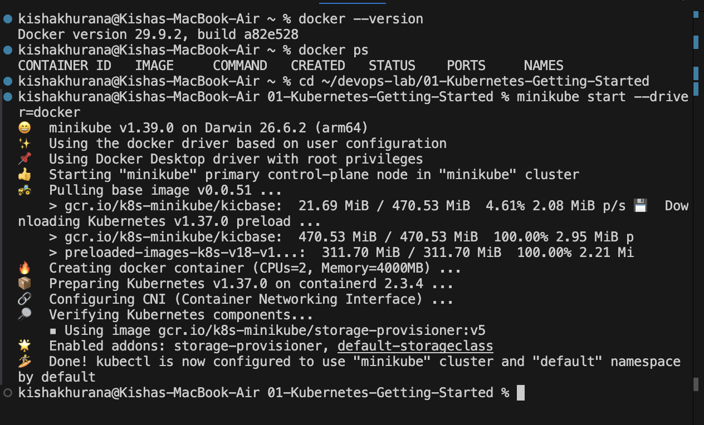
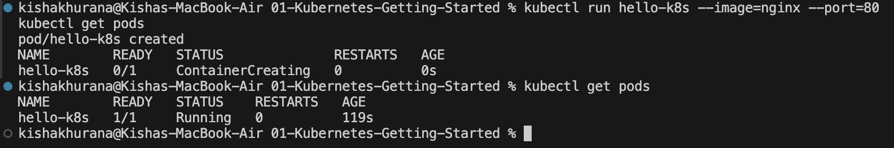
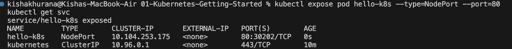
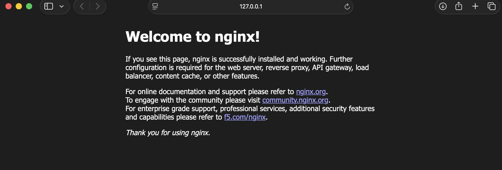

# Exercise 1: Kubernetes Getting Started (Hello Pod)

## Objective
Run a first application on Kubernetes using Minikube and access it from the browser.

## Scenario
Acting as a DevOps engineer at Zepto, deploy a lightweight web app (simulated by the `nginx` image) on Kubernetes so that it is always running, portable and can be scaled later.

## Environment
| Tool | Version |
|---|---|
| OS | macOS (Apple Silicon, arm64) |
| Docker Desktop (Docker driver) | Docker 29.9.2 |
| Minikube | v1.39.0 |
| kubectl client | v1.37.1 |
| Kubernetes (cluster) | v1.37.0 |

## Steps and Commands

### 1. Start a local Kubernetes cluster
```bash
minikube start --driver=docker
```


### 2. Create the Pod from the nginx image
```bash
kubectl run hello-k8s --image=nginx --port=80
```

### 3. Verify the Pod is running
```bash
kubectl get pods
```
The Pod first shows `ContainerCreating` while the image downloads, then `1/1 Running`.



### 4. Expose the Pod as a NodePort Service
```bash
kubectl expose pod hello-k8s --type=NodePort --port=80
kubectl get svc
```


### 5. Open the app in the browser
```bash
minikube service hello-k8s
```
With the Docker driver on macOS, Minikube opens a tunnel on `127.0.0.1`, so the terminal has to stay open while the page is in use.



## Result
The nginx welcome page loaded in the browser, confirming that the Pod is running and reachable through the NodePort Service.

## Key Learnings
- A **Pod** is the smallest deployable unit in Kubernetes and wraps one or more containers.
- `kubectl run` creates a Pod directly from an image.
- A **Service** gives the Pod a stable network endpoint. The `NodePort` type exposes it outside the cluster.
- A bare Pod is not rescheduled if it is deleted. Deployments and ReplicaSets (later exercises) solve this.

## Comparison with the Lab Manual
All five steps were run exactly as written in the manual. Two additions were needed on macOS:
- `kubectl` was installed separately with Homebrew (`brew install minikube kubectl`), since the manual only lists Minikube.
- Docker Desktop had to be installed and running, and `minikube start` was run with `--driver=docker`, because the manual's plain `minikube start` could not detect a driver on this machine.