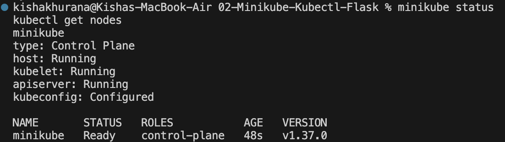
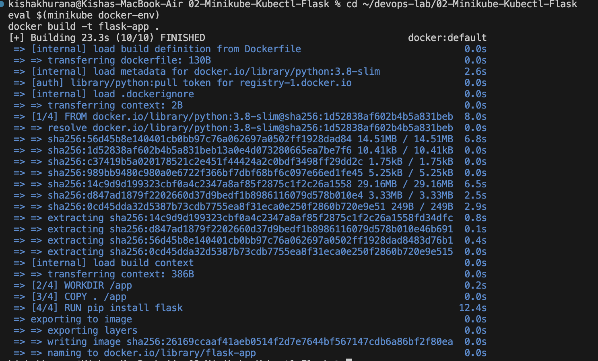
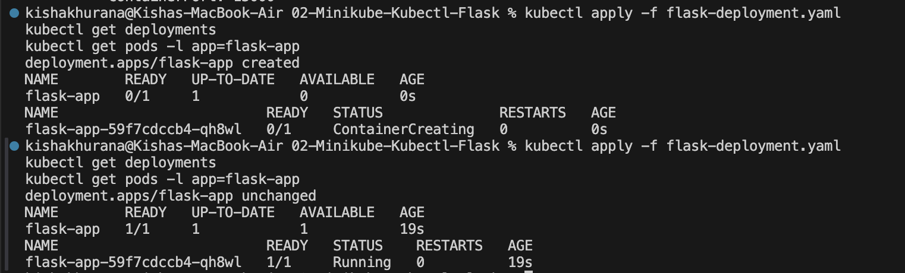
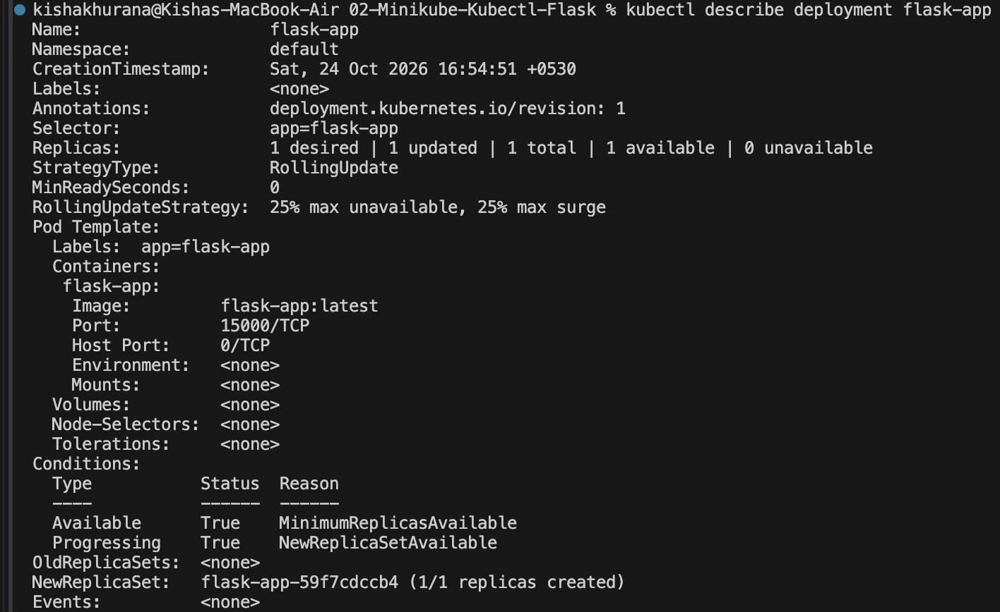
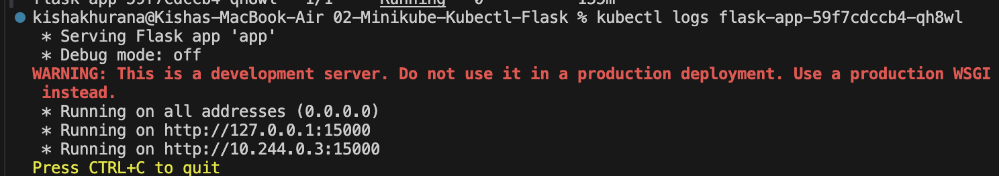
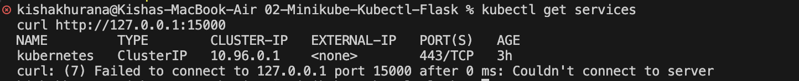
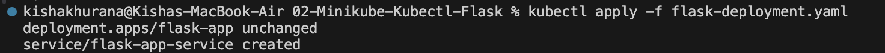

# Exercise 2: Deploy a Flask App on Minikube using kubectl and YAML

## Objective
Use Minikube to run a single-node Kubernetes cluster and deploy a Python Flask application with a Deployment, then expose it with a Service.

## Environment
| Tool | Version |
|---|---|
| OS | macOS (Apple Silicon, arm64) |
| Docker Desktop | Docker 29.9.2 |
| Minikube | v1.39.0 (Docker driver, **docker** container runtime) |
| kubectl client | v1.37.1 |
| Kubernetes (cluster) | v1.37.0 |

## Files in this Folder
| File | Purpose |
|---|---|
| `app.py` | Flask application listening on port 15000 |
| `Dockerfile` | Builds the `flask-app` image from `python:3.8-slim` |
| `flask-deployment.yaml` | Deployment and NodePort Service |
| `screenshots/` | Evidence of each step |

## Steps and Commands

### 1. Start Minikube
```bash
minikube start --driver=docker --container-runtime=docker
minikube status
kubectl get nodes
```


### 2. Create the Flask app and Dockerfile
`app.py` returns a greeting on `/` and runs on `0.0.0.0:15000`. The `Dockerfile` copies the app into a `python:3.8-slim` image, installs Flask and runs `app.py`.

### 3. Build the image with Minikube's Docker daemon
```bash
eval $(minikube docker-env)
docker build -t flask-app .
```
Building inside Minikube's Docker makes the image available to the cluster without pushing it to a registry.



### 4. Deploy the application
The first version of `flask-deployment.yaml` contained only the Deployment. `imagePullPolicy: Never` makes Kubernetes use the local `flask-app:latest` image instead of pulling from a registry.
```bash
kubectl apply -f flask-deployment.yaml
kubectl get deployments
kubectl get pods -l app=flask-app
```


### 5. Describe the Deployment
```bash
kubectl describe deployment flask-app
```


### 6. View the pod logs
```bash
kubectl logs flask-app-59f7cdccb4-qh8wl
```
The logs show Flask running on `0.0.0.0:15000`.



### 7. Show the app is not reachable without a Service
```bash
kubectl get services
curl http://127.0.0.1:15000
```
Only the default `kubernetes` service exists and `curl` cannot connect. The container port is open inside the cluster, but nothing exposes it outside.



### 8. Add a NodePort Service
The Service section was added to `flask-deployment.yaml` with `port: 15000` and `targetPort: 15000`.
```bash
kubectl apply -f flask-deployment.yaml
```
Output: `deployment.apps/flask-app unchanged` and `service/flask-app-service created`.



### 9. Access the app
```bash
minikube service flask-app-service --url
```
The terminal running this command must stay open (Docker driver on macOS). From a second terminal:
```bash
curl http://127.0.0.1:56093
```
Response: `Hello from Flask on Kubernetes!`


## Port vs targetPort
- `port` is the port the Service exposes.
- `targetPort` is the port the container listens on.
- Here both are 15000, so traffic flows: client, Service port 15000, container port 15000.

## Key Learnings
- A **Deployment** keeps the desired number of Pods running and manages updates.
- A Pod is not reachable from outside the cluster until a **Service** exposes it.
- `minikube docker-env` lets you build images straight into the cluster's Docker daemon.
- `imagePullPolicy: Never` forces the use of local images.

## Comparison with the Lab Manual
The steps follow the manual in order. Differences on this machine:
- `minikube start` was run with `--driver=docker --container-runtime=docker`. Minikube v1.39 defaults to the containerd runtime, where `minikube docker-env` is experimental, and the first `docker build` failed with a BuildKit error (`failed to inspect pulled image moby/buildkit`). Recreating the cluster with the docker runtime fixed it.
- The manual's sample output is from Linux/WSL. On macOS the `--url` command prints a `127.0.0.1` port and the terminal must stay open.
- Pod names and the service port differ from the manual's examples because they are generated.