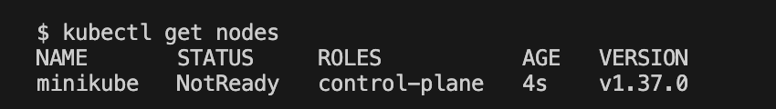
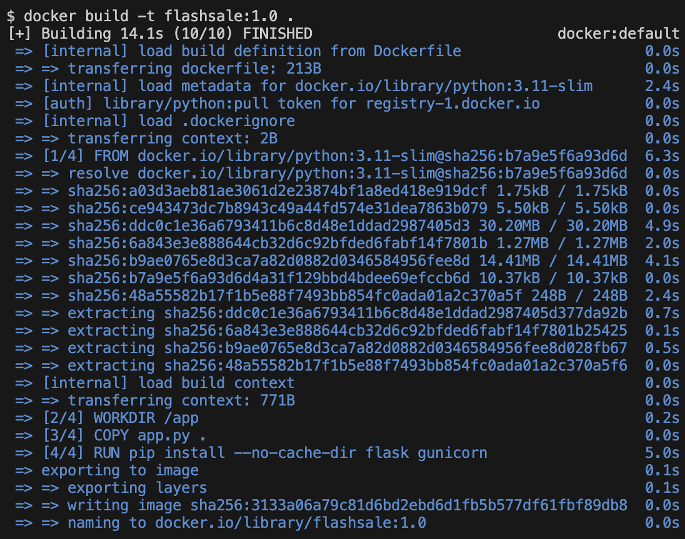
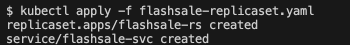
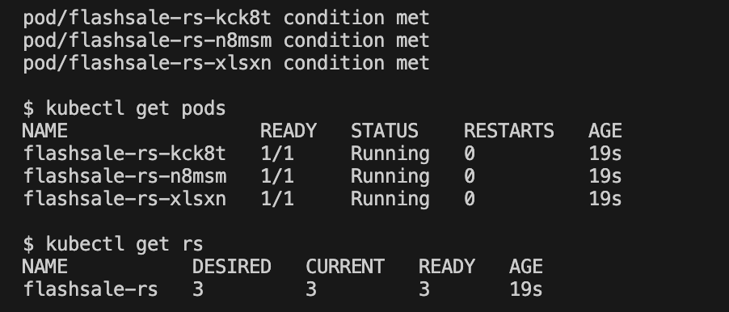
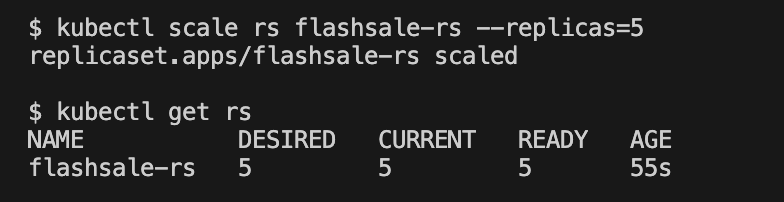
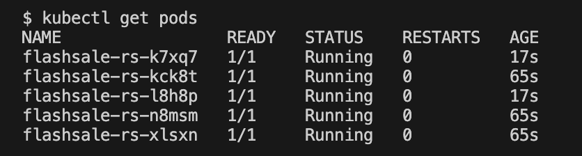
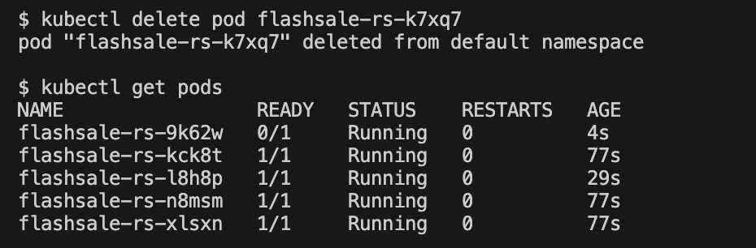
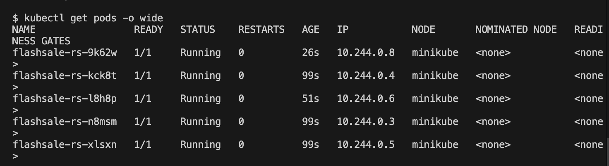

# Exercise 3: Scaling Flask App on Single Node using ReplicaSets

## Real-Life Use Case: E-commerce Flash Sale
During a flash sale, a Flask service that normally handles 100 requests per minute may suddenly receive 10,000. A single Pod would crash under that load. A **ReplicaSet** runs several identical Pods and keeps that number constant, so traffic can be spread across them and the service can be scaled back down after the sale.

## Objective
- Understand ReplicaSets and Pods
- Scale the Flask app
- Observe Pod distribution and self-healing

## Environment
| Tool | Version |
|---|---|
| OS | macOS (Apple Silicon, arm64) |
| Docker Desktop | Docker 29.9.2 |
| Minikube | v1.39.0 (Docker driver, docker container runtime, 1 node) |
| kubectl client | v1.37.1 |
| Kubernetes (cluster) | v1.37.0 |

## Files in this Folder
| File | Purpose |
|---|---|
| `app.py` | Flash sale Flask app with `/`, `/buy` and `/health` endpoints |
| `Dockerfile` | Builds the `flashsale:1.0` image (gunicorn, port 5000) |
| `flashsale-replicaset.yaml` | ReplicaSet (3 replicas, probes, resource limits) and ClusterIP Service |
| `screenshots/` | Evidence of each step |

## Steps and Commands

### 1. Clean up and start a single-node cluster
```bash
minikube stop
minikube delete
minikube start --nodes=1 --driver=docker --container-runtime=docker
kubectl get nodes
```


### 2. Build the image inside Minikube's Docker daemon
```bash
eval $(minikube docker-env)
docker build -t flashsale:1.0 .
```


### 3. Apply the ReplicaSet
```bash
kubectl apply -f flashsale-replicaset.yaml
```
Creates `replicaset.apps/flashsale-rs` and `service/flashsale-svc`.



### 4. Verify the Pods and ReplicaSet
```bash
kubectl get pods
kubectl get rs
```
Three Pods are `Running` and the ReplicaSet shows 3 desired, 3 current, 3 ready.



### 5. Scale to 5 replicas
```bash
kubectl scale rs flashsale-rs --replicas=5
kubectl get rs
kubectl get pods
```



### 6. Delete one Pod: self-healing
```bash
kubectl delete pod <pod-name>
kubectl get pods
```
A replacement Pod (with a new name and a young age) is created immediately, so the count returns to 5.



### 7. Pod distribution across nodes
```bash
kubectl get pods -o wide
```
All five Pods run on the single `minikube` node.



## Questions and Answers
1. **Initial number of replicas?** 3.
2. **Pods running after applying the ReplicaSet?** 3.
3. **What happens when scaled to 5?** Kubernetes creates 2 additional Pods to reach 5.
4. **What happens when one Pod is deleted?** The ReplicaSet creates a new Pod to keep 5 running.
5. **How does Kubernetes maintain the desired count?** A controller keeps comparing the running Pods with the desired replicas and creates or deletes Pods to match.
6. **How many nodes are running?** 1.
7. **Where do the Pods run?** All 5 Pods run on the single node.

## Key Learnings
- Each Pod is an identical worker, and scaling means creating more copies.
- If a Pod fails, the ReplicaSet creates another, so users do not notice downtime.
- Pods can be added when demand spikes and removed when it falls.

## Comparison with the Lab Manual
The manual's Exercise 3 has name mismatches. These were fixed with the smallest possible changes:
| Manual | What was done | Reason |
|---|---|---|
| `minikube start --nodes=1` | added `--driver=docker --container-runtime=docker` | Minikube v1.39 defaults to containerd, where `minikube docker-env` does not work reliably |
| Dockerfile: `COPY ex3-flash-sale.py .` | `COPY app.py .` | the application file is `app.py` |
| `docker build -t flask-app .` | `docker build -t flashsale:1.0 .` | the ReplicaSet YAML uses `flashsale:1.0` |
| `kubectl scale rs flask-app-rs` | `kubectl scale rs flashsale-rs` | the ReplicaSet in the YAML is named `flashsale-rs` |
| YAML applied before the image build | image built first, then YAML applied | Pods need the image to start |
| Push the image to a Docker Hub repository | not done | the YAML uses the local image inside Minikube, so no registry is needed |
