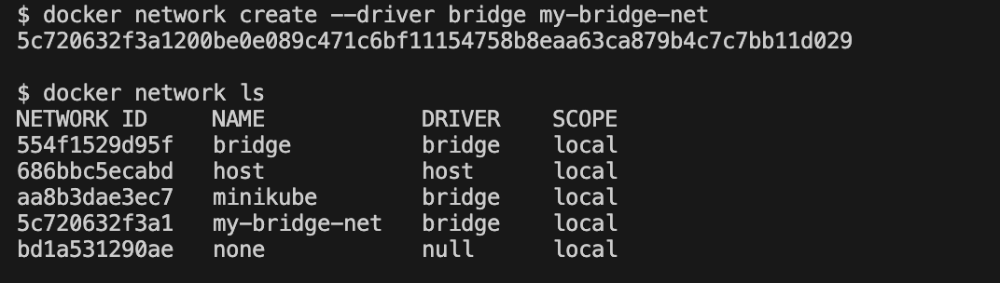
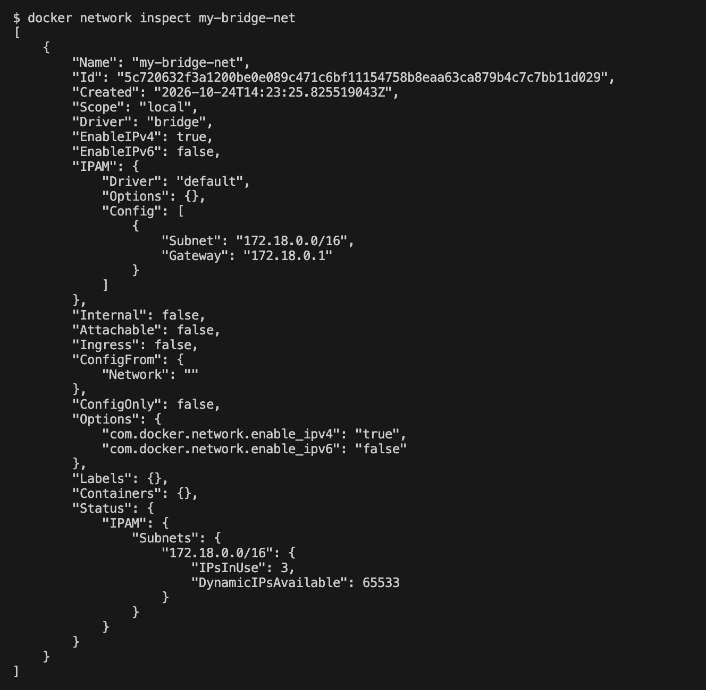
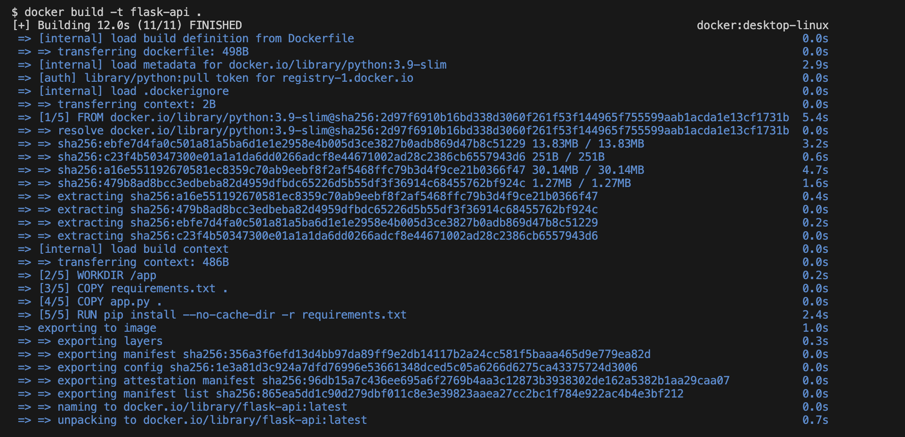
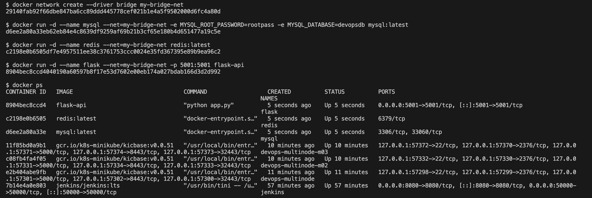
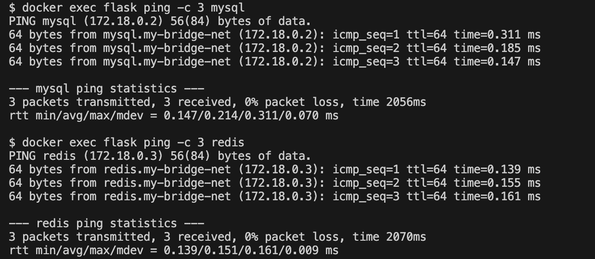
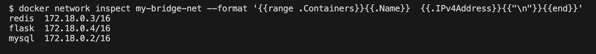
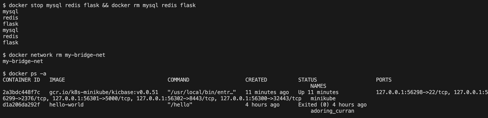

# Exercise 4: Docker Networking with Multiple Containers

## Objective
Understand Docker networking and configure a multi-container application on a user-defined bridge network.

## Scenario
A web application made of three containers:
- a Python **Flask** web server (container 1)
- a **MySQL** database (container 2)
- a **Redis** cache (container 3)

```
Host (localhost:5001)
        |
        v
  Flask container (flask :5001)
        |
   my-bridge-net
     /        \
    v          v
 MySQL       Redis
 (mysql)     (redis)
```
Only the Flask port is published to the host (`-p 5001:5001`). MySQL and Redis are reachable by the other containers through the network, using their container names.

## Environment
| Tool | Version |
|---|---|
| OS | macOS (Apple Silicon, arm64) |
| Docker Desktop | Docker 29.9.2 |
| Images | `python:3.9-slim`, `mysql:latest`, `redis:latest` |

## Files in this Folder
| File | Purpose |
|---|---|
| `app.py` | Flask REST API with an `/about` endpoint on port 5001 |
| `requirements.txt` | `Flask==2.0.1` and `Werkzeug==2.0.3` |
| `Dockerfile` | Builds the `flask-api` image |
| `screenshots/` | Evidence of each step |

## Tasks and Commands

### Task 1-2: Create and verify the bridge network
```bash
docker network create --driver bridge my-bridge-net
docker network ls
```


### Task 3: Inspect the network
```bash
docker network inspect my-bridge-net
```
The network has a subnet and gateway, and no containers yet.



### Task 4: Build the Flask image
```bash
docker build -t flask-api .
```


### Task 4: Launch the containers
```bash
docker run -d --name mysql --net=my-bridge-net -e MYSQL_ROOT_PASSWORD=rootpass -e MYSQL_DATABASE=devopsdb mysql:latest
docker run -d --name redis --net=my-bridge-net redis:latest
docker run -d --name flask --net=my-bridge-net -p 5001:5001 flask-api
docker ps
```


### Test the API from the host
```bash
curl http://localhost:5001/about
```


### Task 5: Test connectivity between containers
`ping` is not in the `python:3.9-slim` image, so `iputils-ping` was installed inside the `flask` container first.
```bash
docker exec flask ping -c 3 mysql
docker exec flask ping -c 3 redis
```
The container names resolve to the containers' IP addresses on the bridge network.



The containers attached to the network, with their addresses:
```bash
docker network inspect my-bridge-net --format '{{range .Containers}}{{.Name}}  {{.IPv4Address}}{{"\n"}}{{end}}'
```


### Task 6: Clean up
```bash
docker stop mysql redis flask && docker rm mysql redis flask
docker network rm my-bridge-net
```


## Questions and Answers
1. **What is the purpose of the `--net` flag in `docker run`?** It specifies the network the container connects to.
2. **How do containers on the same network communicate?** Using container names (resolved by Docker's built-in DNS) or IP addresses.
3. **Bridge network vs host network?** A bridge network isolates containers in a private network and lets them talk through it. A host network shares the host's network stack directly.
4. **How do you expose a container's port to the host?** With the `-p` flag, for example `-p 5001:5001`.

## Comparison with the Lab Manual
| Manual | What was done | Reason |
|---|---|---|
| `app.run(debug=True, port=5001)` | added `host='0.0.0.0'` | without it Flask listens only on 127.0.0.1 inside the container, so `-p 5001:5001` cannot reach it |
| `requirements.txt`: `Flask==2.0.1` | added `Werkzeug==2.0.3` | Flask 2.0.1 fails with newer Werkzeug versions |
| `docker run ... mysql:latest` | added `-e MYSQL_ROOT_PASSWORD=rootpass -e MYSQL_DATABASE=devopsdb` | the MySQL image exits at startup without a root password |
| `docker exec -it flask bash`, then `ping` | `ping` installed with `apt-get` and run with `docker exec` | the slim Python image has no `ping`; running it with `docker exec` gives the same result without an interactive shell |
| Sample output shows fixed IDs and IPs | real IDs and IPs differ | they are generated by Docker |
