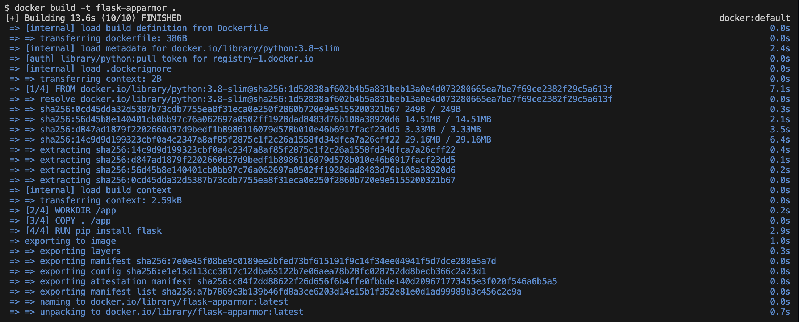
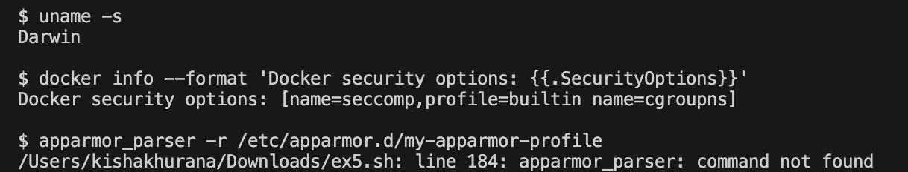
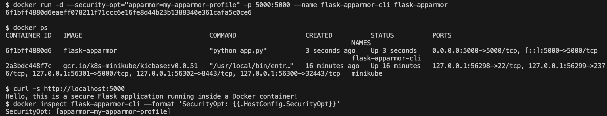
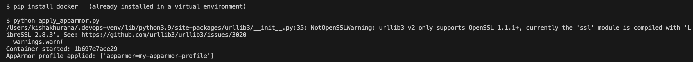
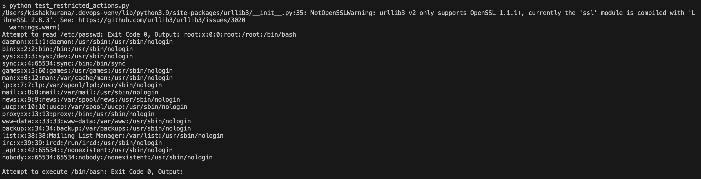

# Exercise 5: Docker Security with AppArmor and Python

## Objective
Understand how to secure Docker containers with AppArmor profiles, apply a profile using the Docker SDK for Python, and test restricted actions inside the container.

## Scenario
A Python Flask application runs in a Docker container. It must be restricted from reading sensitive directories and from executing binaries.

## Environment
| Tool | Version |
|---|---|
| OS | macOS (Apple Silicon, arm64) |
| Docker Desktop | Docker 29.9.2 |
| Python | python3 with the `docker` SDK in a virtual environment |

## Files in this Folder
| File | Purpose |
|---|---|
| `app.py` | Flask application on port 5000 |
| `Dockerfile` | Builds the `flask-apparmor` image |
| `my-apparmor-profile` | AppArmor profile (deny `/etc` and `/var`, deny executing binaries, restrict capabilities) |
| `apply_apparmor.py` | Builds and runs the container with the profile using the Docker SDK, then inspects `SecurityOpt` |
| `test_restricted_actions.py` | Tries `cat /etc/passwd` and `/bin/bash` inside the container |
| `screenshots/` | Evidence of each step |

## Tasks and Commands

### Task 1-2: Flask app and Dockerfile, build the image
```bash
docker build -t flask-apparmor .
```


### Task 3: Create and load the AppArmor profile
The manual saves the profile at `/etc/apparmor.d/my-apparmor-profile` and loads it with `apparmor_parser`. That tool and directory exist only on Linux with AppArmor. On macOS the command is not found, and Docker's own security options show that AppArmor is not available:
```bash
uname -s
docker info --format 'Docker security options: {{.SecurityOptions}}'
apparmor_parser -r /etc/apparmor.d/my-apparmor-profile
```


The container was still started with the profile option, exactly as the manual shows:
```bash
docker run -d --security-opt="apparmor=my-apparmor-profile" -p 5000:5000 flask-apparmor
```


### Task 4: Apply the profile with the Docker SDK for Python
```bash
pip install docker
python apply_apparmor.py
```
`HostConfig.SecurityOpt` shows `apparmor=my-apparmor-profile`, which confirms the option was passed to Docker.



### Task 5: Test restricted actions
```bash
python test_restricted_actions.py
```
Result: reading `/etc/passwd` returned exit code 0 and executing `/bin/bash` returned exit code 0. The manual's expected output with an enforced profile is exit code 1 and 126.



Both actions succeeded (exit code 0), so the profile was **not enforced**. Docker Desktop on macOS runs containers inside a Linux VM whose kernel does not have AppArmor enabled (the Docker security options in screenshot 02 list no `apparmor` entry), so Docker silently ignores the `--security-opt apparmor=...` setting. The commands, scripts and profile are correct and would enforce on a Linux host with AppArmor.

## Questions and Answers
1. **Purpose of AppArmor with Docker?** It enforces security policies and confines an application to a limited set of resources, adding a layer of security.
2. **How do profiles secure a container?** They define what the application can and cannot do: file access, network, executing binaries, capabilities.
3. **Why restrict `/etc/` and `/var/`?** They hold configuration and sensitive data. Restricting them reduces the damage if the container is compromised.
4. **What else can be restricted?** Network access, binding to ports, executing binaries, writing to directories and capabilities such as `cap_sys_admin`.
5. **How to verify a profile is applied?** Inspect the container: `HostConfig.SecurityOpt` lists the profile. Enforcement can then be confirmed by testing a restricted action.

## Comparison with the Lab Manual
| Manual | What happened | Reason |
|---|---|---|
| `sudo apparmor_parser -r /etc/apparmor.d/my-apparmor-profile` | command not found | macOS has no AppArmor tools or `/etc/apparmor.d`; `sudo` was left out because the command cannot run here |
| Profile enforced, exit codes 1 and 126 | exit codes 0 and 0 | AppArmor is not enabled in Docker Desktop's Linux VM, so the profile is ignored |
| `pip install docker` | installed in a virtual environment | keeps the system Python untouched |
| Sample output shows fixed IDs and layer hashes | real values differ | generated by Docker |
All files and commands were created exactly as in the manual. The only difference is the platform limitation above.
