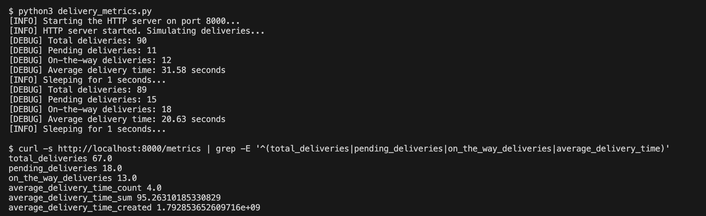
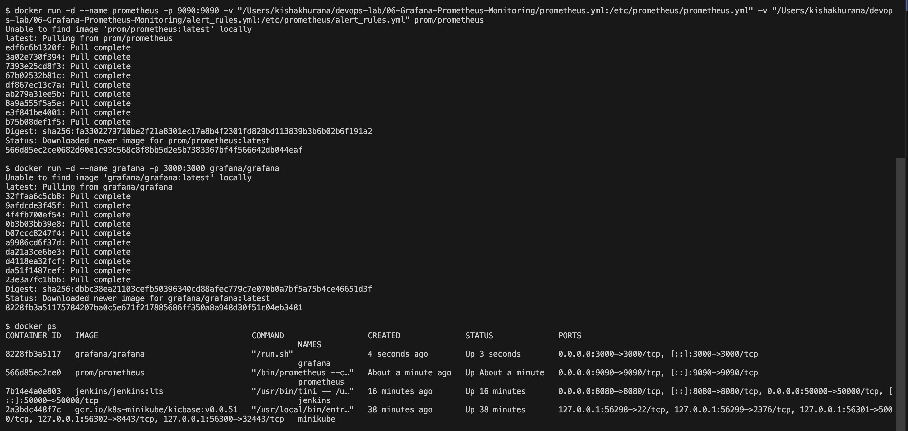
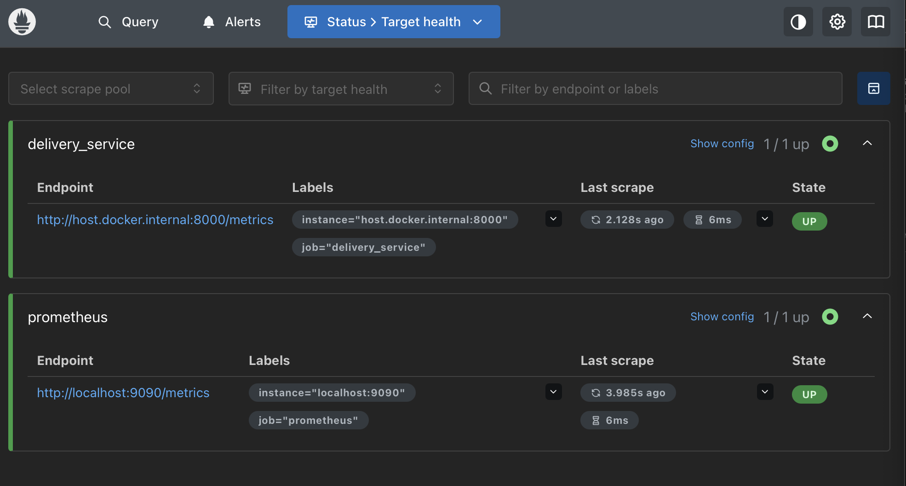
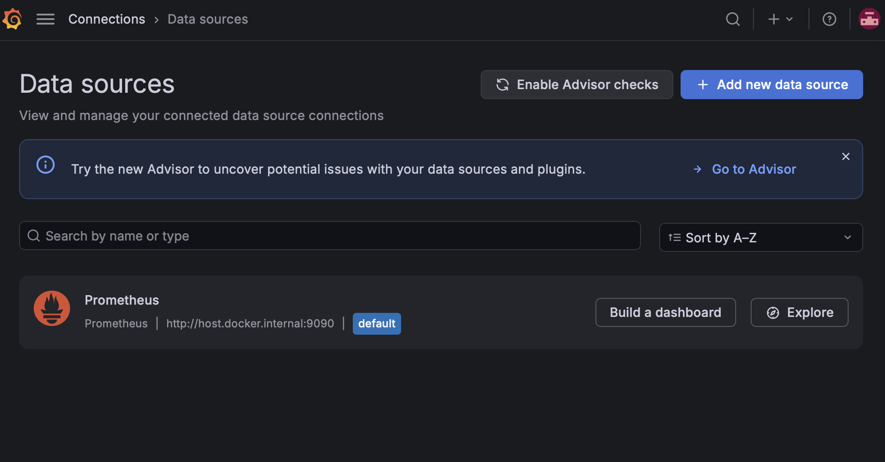
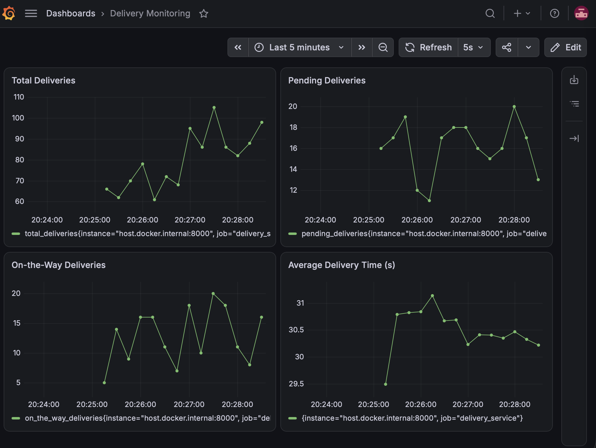
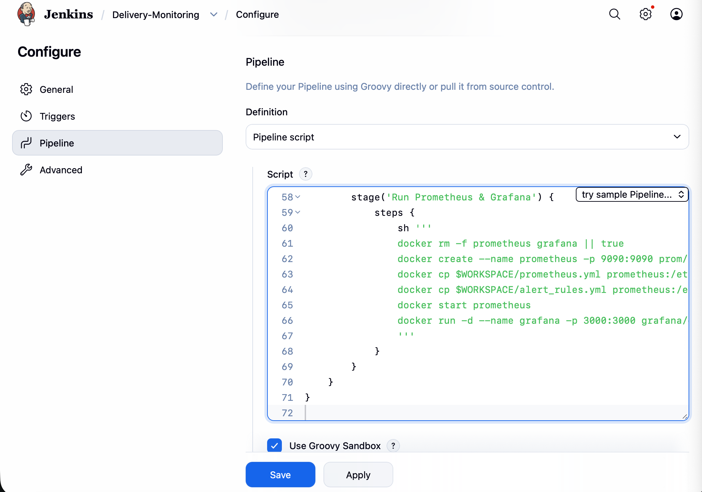
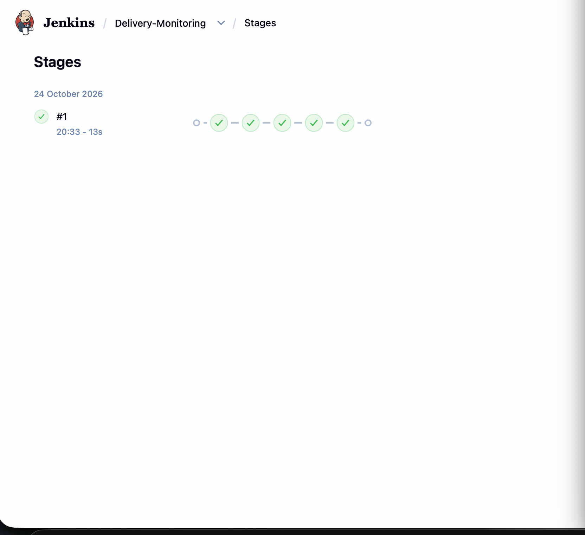
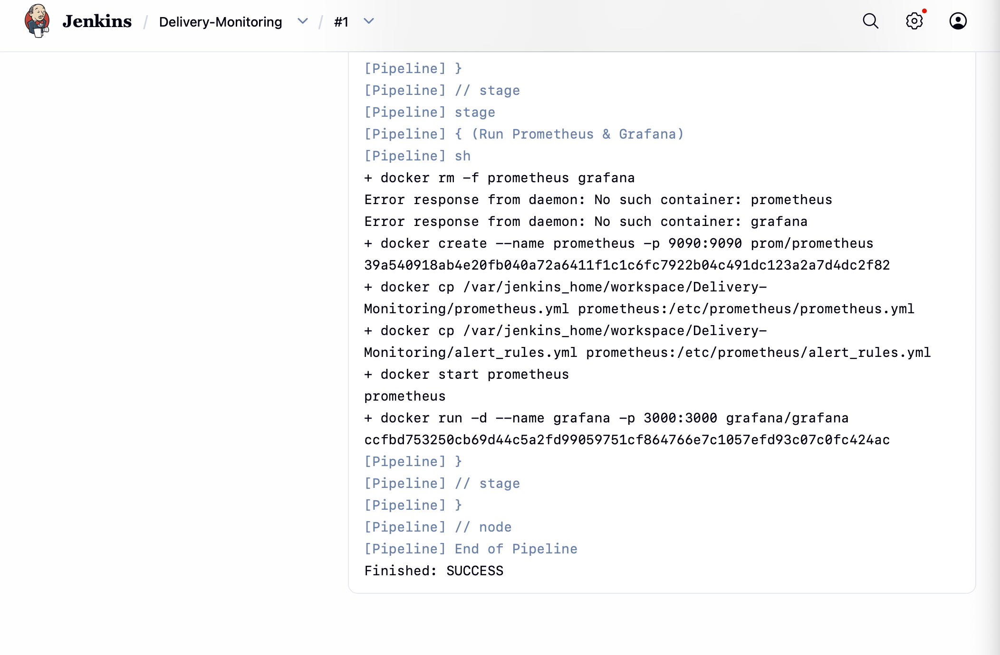
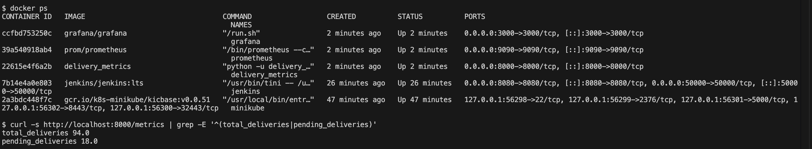
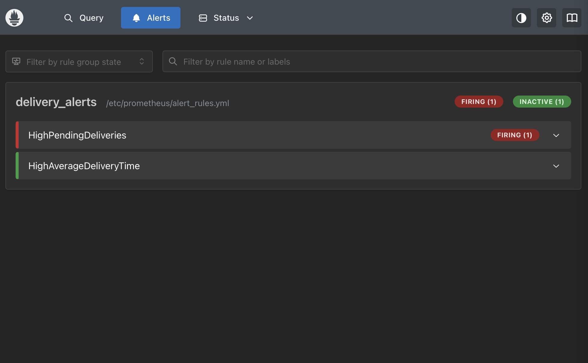

# Exercise 6: Real-Time Operations Monitoring and Alerting

## Objective
As a DevOps engineer at ZAPPTTO, a fast-paced delivery service, build monitoring that gives real-time insight into delivery performance: simulate delivery metrics with Python, scrape them with Prometheus, raise alerts, visualise them in Grafana and automate the stack with a Jenkins pipeline.

## Environment
| Tool | Version |
|---|---|
| OS | macOS (Apple Silicon, arm64) |
| Docker Desktop | Docker 29.9.2 |
| Python | python3 with `prometheus-client` (virtual environment) |
| Prometheus, Grafana | `prom/prometheus` and `grafana/grafana` (latest images) |
| Jenkins | `jenkins/jenkins:lts` in Docker (set up in Exercise 7) |

## Files in this Folder
| File | Purpose |
|---|---|
| `delivery_metrics.py` | Simulates deliveries and exposes Prometheus metrics on port 8000 |
| `prometheus.yml` | Prometheus configuration (scrape targets and rule file) |
| `alert_rules.yml` | Alert rules for high pending deliveries and high average delivery time |
| `Dockerfile` | Packages `delivery_metrics.py` as an image (needed by the Jenkins pipeline) |
| `Jenkinsfile` | Pipeline that builds the app image and starts Prometheus and Grafana |
| `screenshots/` | Evidence of each step |

## Architecture
```
delivery_metrics.py  (/metrics on :8000)
        ^  scraped every 5s
        |
   Prometheus (:9090)  -- alert_rules.yml --> alerts
        ^
        | data source
   Grafana (:3000)  -- Delivery Monitoring dashboard
```

## Steps

### Step 1: Run the metrics application
The script defines the metrics `total_deliveries`, `pending_deliveries`, `on_the_way_deliveries` (gauges) and `average_delivery_time` (summary), updates them every second and serves them with `start_http_server(8000)`. The `/metrics` endpoint is created automatically by `prometheus_client`.
```bash
python3 delivery_metrics.py
curl http://localhost:8000/metrics
```


### Step 2: Run Prometheus
```bash
docker run -d --name prometheus -p 9090:9090 \
  -v "$PWD/prometheus.yml:/etc/prometheus/prometheus.yml" \
  -v "$PWD/alert_rules.yml:/etc/prometheus/alert_rules.yml" prom/prometheus
```
Prometheus scrapes `host.docker.internal:8000`, which is how a container reaches a service on the Mac host.

### Step 3: Run Grafana
```bash
docker run -d --name grafana -p 3000:3000 grafana/grafana
docker ps
```


**Prometheus targets:** both `prometheus` and `delivery_service` are UP.



**Grafana data source:** Prometheus at `http://host.docker.internal:9090`.



**Grafana dashboard** with four panels: Total Deliveries, Pending Deliveries, On-the-Way Deliveries and Average Delivery Time (`average_delivery_time_sum / average_delivery_time_count`).



### Step 4: Alerts
`alert_rules.yml` defines two alerts:
- `HighPendingDeliveries`: `pending_deliveries > 10` for 15 seconds (warning)
- `HighAverageDeliveryTime`: `average_delivery_time_sum / average_delivery_time_count > 30` (critical)

### Step 5: Jenkins pipeline
The `Jenkinsfile` has five stages: **Pre-check Docker**, **Setup Workspace**, **Build Docker Image**, **Run Application** and **Run Prometheus & Grafana**. It was added as a Pipeline job (Pipeline script) in Jenkins and run with **Build Now**.





The pipeline started the application, Prometheus and Grafana containers:



### Step 6: Simulate alerts
`pending_deliveries` was raised by changing the line in `delivery_metrics.py` to `pending = random.randint(50, 100)`. After restarting the script and Prometheus, `HighPendingDeliveries` fired.



The file in this folder is the Step 1 version (`randint(10, 20)`); the change was reverted after the test.

## Expected Outputs Checklist
1. Metrics endpoint at `http://localhost:8000/metrics`: done.
2. Prometheus scraping the metrics: done (targets UP).
3. Grafana dashboard with delivery metrics: done.
4. Jenkins pipeline with a successful build and Docker command logs: done.
5. Prometheus alerts for high pending deliveries: done.

## Key Learnings
- Prometheus **pulls** metrics from an HTTP endpoint on a schedule; the app only has to expose `/metrics`.
- Alert rules are expressions over metrics and fire when they hold for a given time.
- Grafana reads from Prometheus and turns the metrics into live dashboards.
- Jenkins can automate building and starting the whole monitoring stack.

## Comparison with the Lab Manual
| Manual | What was done | Reason |
|---|---|---|
| Prometheus target `172.17.0.1:8000`; Grafana data source `http://172.17.0.1:9090` | `host.docker.internal` for both | `172.17.0.1` is the Linux Docker bridge address; on macOS the manual's own note says to use `host.docker.internal` |
| `docker run --network=host ... -v ./prometheus.yml:...` | `-p 9090:9090` and absolute paths in `-v` | host networking does not publish ports on Docker Desktop; absolute paths are reliable for bind mounts |
| `prometheus.yml` without a `global` section | added `scrape_interval: 5s` and `evaluation_interval: 5s` | alerts and graphs appear within seconds instead of minutes |
| Manual's folder tree names the file `alerts_rules.yml` | file is `alert_rules.yml` | the manual's `prometheus.yml` and Jenkinsfile reference `alert_rules.yml` |
| No `Dockerfile` given | added a `Dockerfile` for `delivery_metrics.py` | the Jenkinsfile runs `docker build -t delivery_metrics .` |
| Grafana data source and dashboard created by clicking in the UI | created through the Grafana HTTP API with the same settings and the four panels from the manual | faster and repeatable; the screenshots show the result in the Grafana UI |
| Jenkinsfile `localSourcePath = '/path/to/your/local/files'` | `'/delivery_monitoring'`, with the four files copied into the Jenkins container; `Dockerfile` also copied | the manual's path is a placeholder, and Jenkins runs in a container |
| Jenkinsfile starts Prometheus with `-v $WORKSPACE/...` mounts | `docker create` + `docker cp` + `docker start` | Jenkins runs in Docker, so `$WORKSPACE` exists only inside the Jenkins container, not on the Docker host that would mount it |
| Jenkinsfile `docker run` commands | `docker rm -f` of the old container first | lets the pipeline be re-run without name conflicts |
| Jenkins started as in the manual | Docker socket mounted, Docker CLI installed (Exercise 7) | lets the pipeline run Docker commands on the host's Docker |
