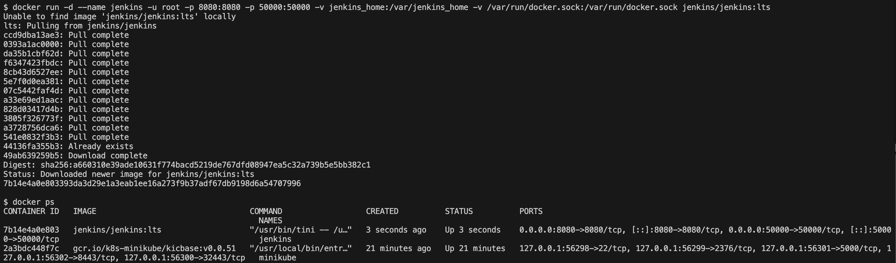
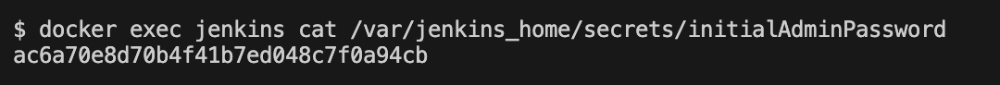
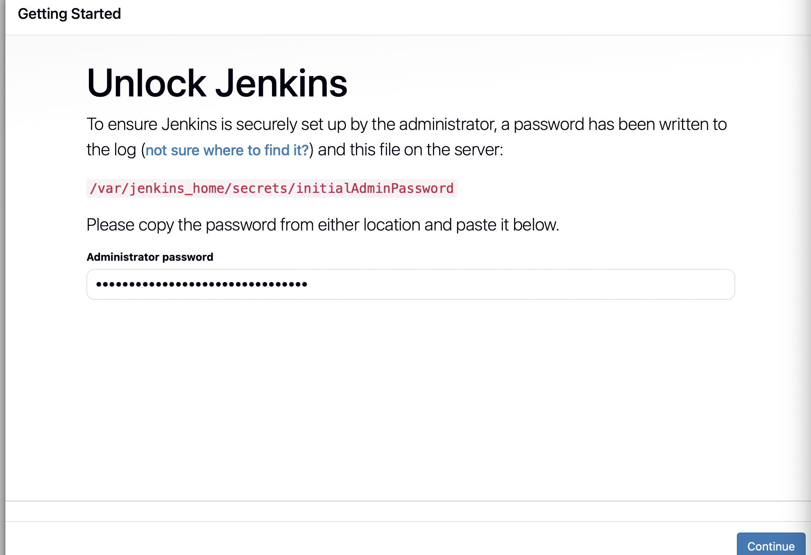
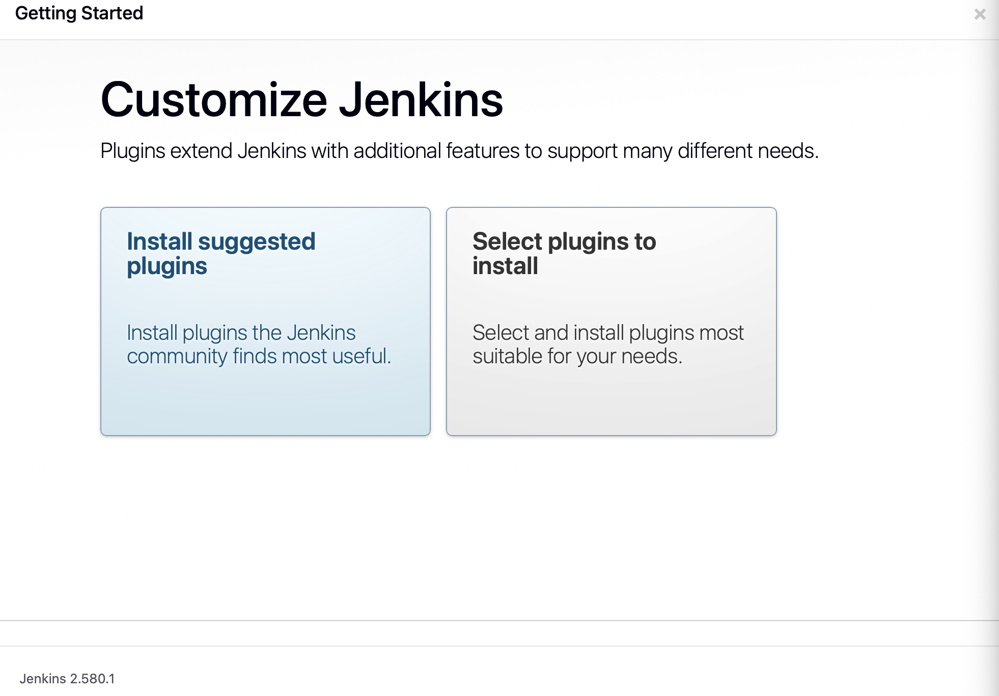
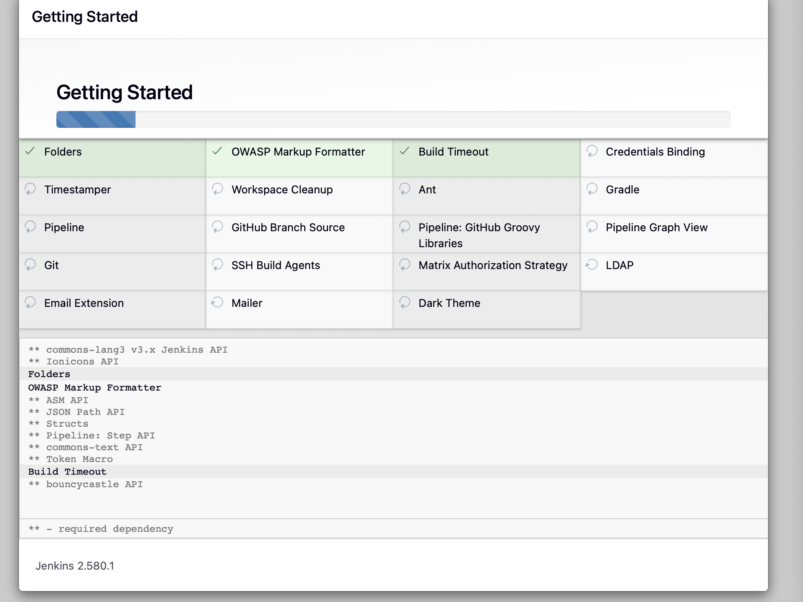
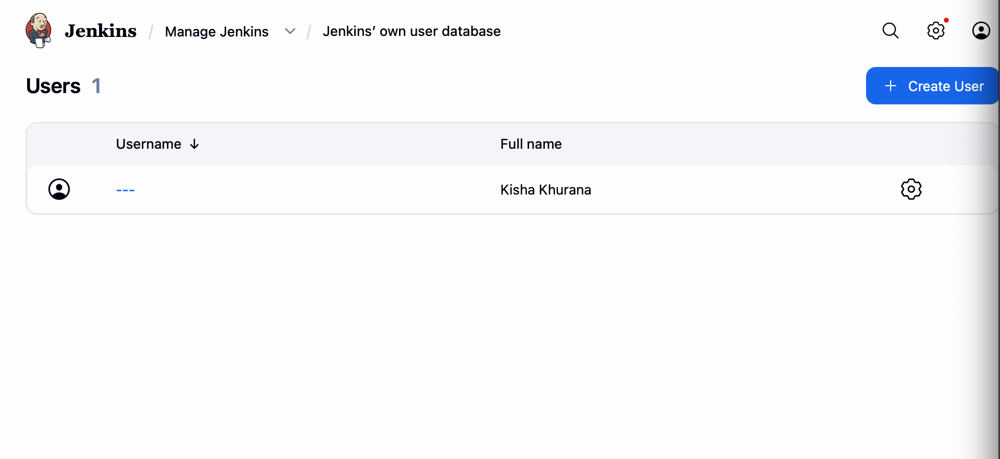
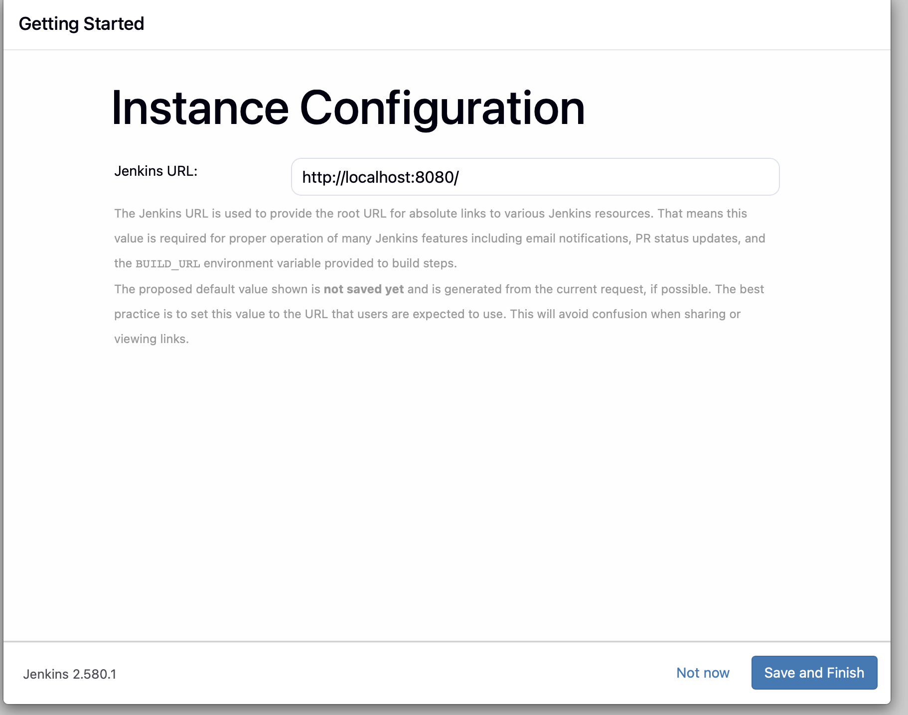
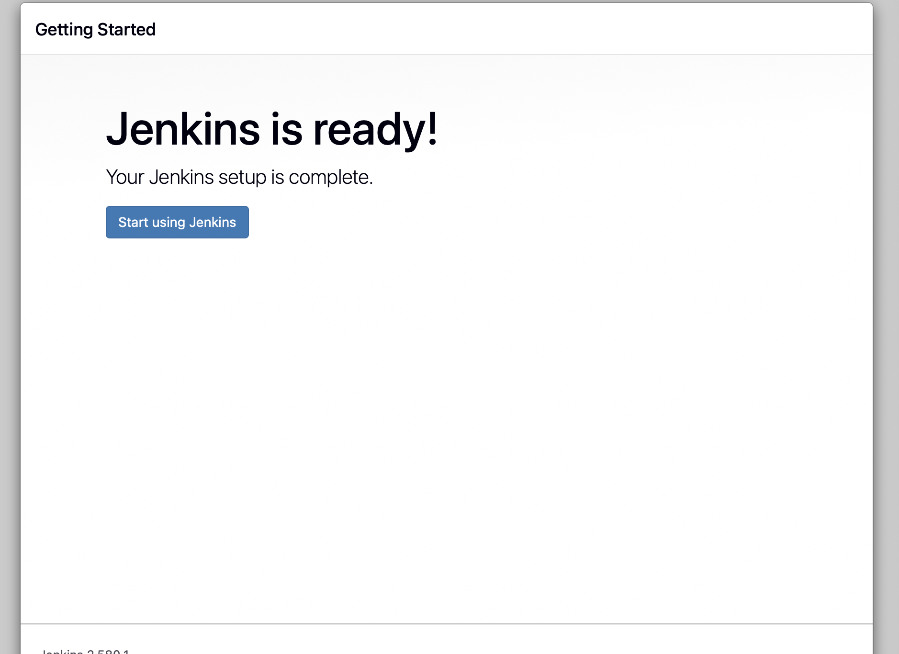
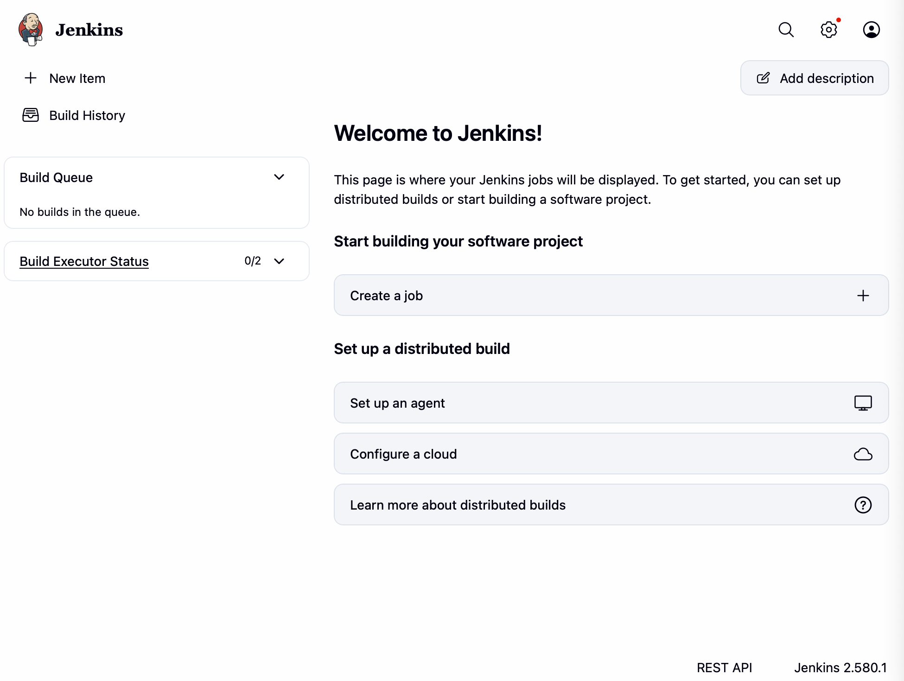

# Exercise 7: Introduction to Continuous Integration (CI) and Jenkins Installation

## Objective
Understand Continuous Integration and install Jenkins with Docker, ready to build CI/CD pipelines in the next exercises.

## What is Continuous Integration?
Continuous Integration is a practice where developers merge their code changes into a shared repository frequently, and every change is automatically built and tested. Problems are found early, while they are still cheap to fix.

**How it works**
1. A developer pushes code to a version control system such as Git.
2. The CI server (for example Jenkins) detects the change and starts a build.
3. The code is built and its dependencies are resolved.
4. Automated tests run.
5. The result (success or failure) is reported back to the developers.

**Benefits**
- Bugs are detected early.
- Developers integrate smoothly and collaborate on one codebase.
- Builds and tests are automated, so delivery is faster.
- Continuous testing keeps quality high and prevents regressions.

## Popular CI/CD Tools
| Tool | Key idea | Best for |
|---|---|---|
| Jenkins | open-source automation server with a large plugin ecosystem | flexible, self-hosted pipelines |
| GitLab CI/CD | built into GitLab, YAML pipelines | teams on GitLab |
| GitHub Actions | workflows defined in the repository, large marketplace | teams on GitHub |
| CircleCI | cloud CI with container-based builds | container-heavy workflows |
| Travis CI | YAML config, popular with open source | open-source projects |
| Bamboo | Atlassian tool integrated with Jira and Bitbucket | Atlassian users |
| TeamCity | JetBrains server with detailed build reports | enterprise setups |
| Azure DevOps Pipelines | Microsoft's pipeline service | Azure users |
| Spinnaker | continuous delivery with canary and blue-green deployments | multi-cloud deployments |
| Buildkite | cloud control plane with self-hosted agents | teams with security concerns |
| Drone | container-native pipelines | container-based workflows |

## Jenkins in Brief
Jenkins is an open-source automation server used to build, test and deploy software, enabling Continuous Integration and Continuous Delivery.
- **Job / Project:** a task Jenkins runs.
- **Build:** one execution of a job.
- **Pipeline:** a series of steps to build, test and deploy.
- **Plugins:** extend Jenkins (Git, Docker, Pipeline and more).
- **Nodes:** machines that run jobs (controller and agents).

## Environment
| Tool | Version |
|---|---|
| OS | macOS (Apple Silicon, arm64) |
| Docker Desktop | Docker 29.9.2 |
| Jenkins | 2.580.1 (`jenkins/jenkins:lts` image) |

## Steps and Commands

### 1. Install Jenkins using Docker
```bash
docker run -d --name jenkins -u root -p 8080:8080 -p 50000:50000 \
  -v jenkins_home:/var/jenkins_home \
  -v /var/run/docker.sock:/var/run/docker.sock \
  jenkins/jenkins:lts
docker ps
```
Port 8080 is the web interface and 50000 is for agents.



### 2. Get the initial admin password
```bash
docker exec jenkins cat /var/jenkins_home/secrets/initialAdminPassword
```


### 3. Open Jenkins at http://localhost:8080 and unlock it


### 4. Customize Jenkins and install the suggested plugins



### 5. Create the first admin user and set the instance configuration



### 6. Jenkins is ready



## Key Learnings
- CI automates build and test on every change and gives fast feedback.
- Running Jenkins in Docker is the quickest way to get a working CI server.
- The first start needs the initial admin password, suggested plugins and an admin user.

## Comparison with the Lab Manual
The manual starts Jenkins with `docker run -d --name jenkins -p 8080:8080 -p 50000:50000 jenkins/jenkins:lts`. The installation screens and steps are the same. Two additions were made for the later exercises, and neither changes the installation itself:
- `-u root` and `-v /var/run/docker.sock:/var/run/docker.sock` were added, and the Docker command-line client was installed inside the container, so that Jenkins pipelines (Exercise 6) can run Docker commands on the host's Docker.
- A named volume (`jenkins_home`) keeps the Jenkins data, so jobs and settings survive restarts.
