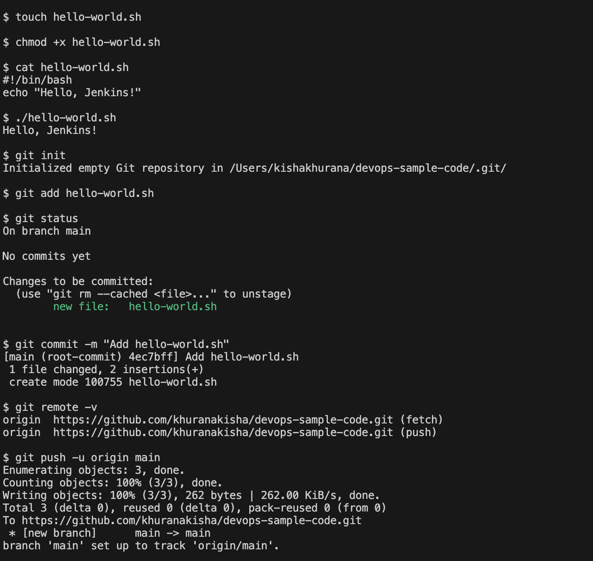
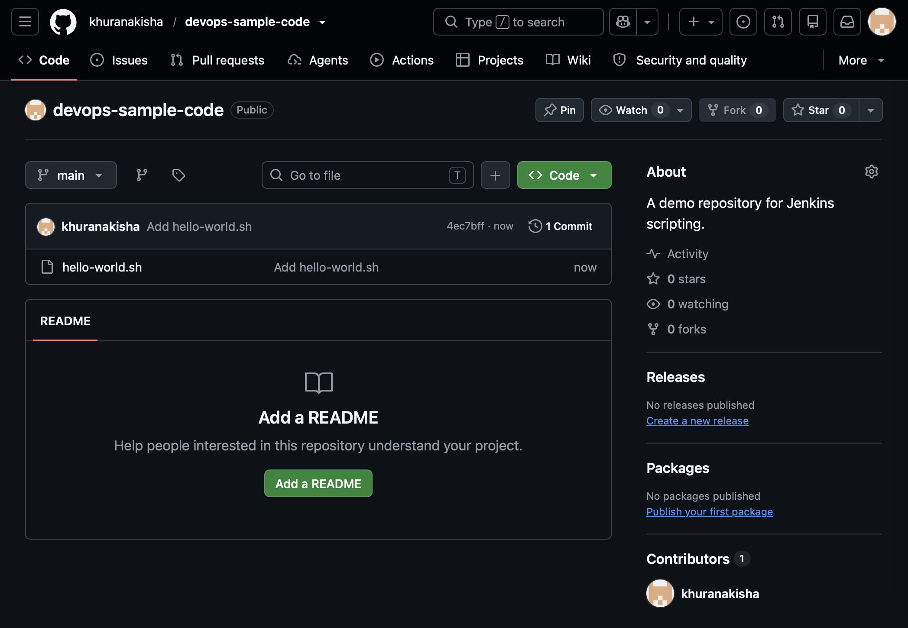
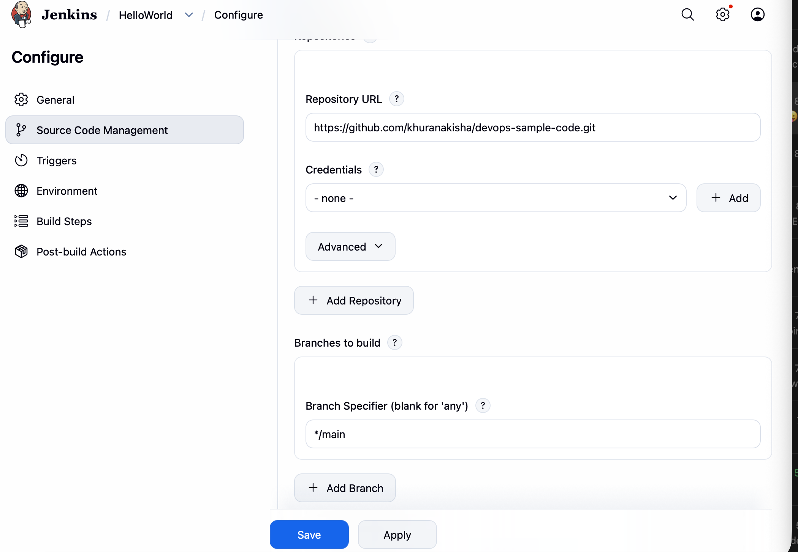
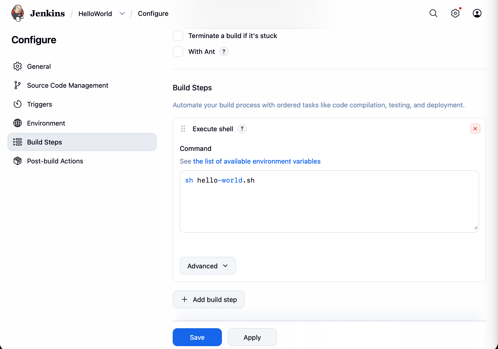
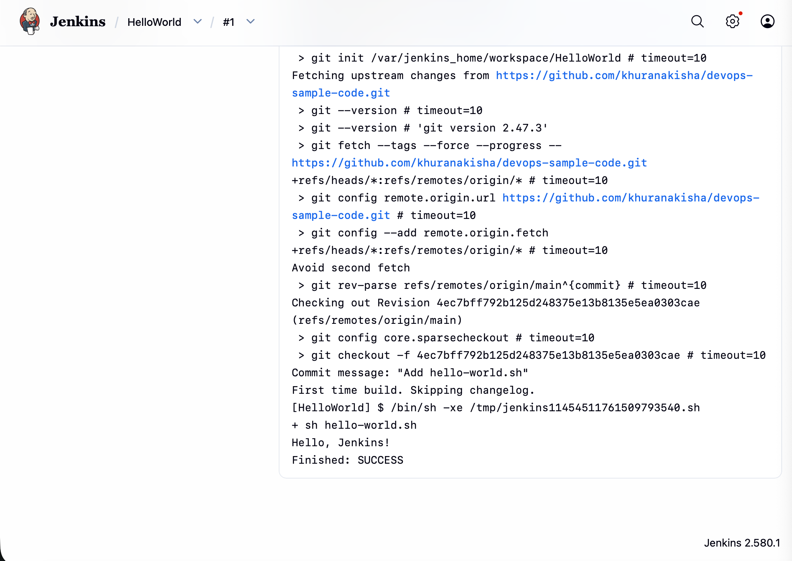

# Exercise 8: Creating a "Hello World" Jenkins Job

## Objective
Create a shell script, push it to GitHub, and run it from a Jenkins Freestyle job that pulls it from the repository.

## Environment
| Tool | Version |
|---|---|
| OS | macOS (Apple Silicon, arm64) |
| Git | installed with the Xcode command-line tools / Homebrew |
| Jenkins | `jenkins/jenkins:lts` in Docker (set up in Exercise 7) |

## Files in this Folder
| File | Purpose |
|---|---|
| `hello-world.sh` | The script run by the Jenkins job (copy of the file in the companion repository) |
| `screenshots/` | Evidence of each step |

## Companion Repository
The script lives in its own public repository, as the manual asks, because Jenkins pulls it from GitHub:
**[khuranakisha/devops-sample-code](https://github.com/khuranakisha/devops-sample-code)**

## Part 1: Put the script on GitHub

### 1. Create the repository
A new public repository named `devops-sample-code` (description: "A demo repository for Jenkins scripting.") was created on GitHub.

### 2. Create the script, commit it and push
```bash
touch hello-world.sh
chmod +x hello-world.sh
git init
git add hello-world.sh
git status
git commit -m "Add hello-world.sh"
git remote add origin https://github.com/khuranakisha/devops-sample-code.git
git push -u origin main
```
`hello-world.sh`:
```bash
#!/bin/bash
echo "Hello, Jenkins!"
```


### 3. Verify on GitHub


## Part 2: The Jenkins job

### 4. Create a Freestyle project
In Jenkins: **New Item**, name `HelloWorld`, type **Freestyle project**. Description: `Hello World! Jenkins job.` Source Code Management is set to **Git** with the repository URL `https://github.com/khuranakisha/devops-sample-code.git` and branch `*/main`.



### 5. Add the build step
**Build Steps > Add build step > Execute shell**, with the command:
```bash
sh hello-world.sh
```


### 6. Save and run the job
Click **Save**, then **Build Now**. Build #1 checks the repository out into the workspace and runs the script.

### 7. View the build output
Build #1 > **Console Output**:



## Key Learnings
- A Jenkins job can pull code from a Git repository and run it on every build.
- A Freestyle project runs a series of build steps; **Execute shell** runs shell commands in the job workspace.
- The console output is the first place to look to confirm what a build did.

## Comparison with the Lab Manual
| Manual | What was done | Reason |
|---|---|---|
| Jenkins job uses the repository's default branch | Branch Specifier changed from `*/master` to `*/main` | Jenkins defaults to `master`, but the repository's branch is `main` |
| Create a fine-grained personal access token for pushing | pushed with the GitHub credentials already set up on this Mac | no separate token step was needed |
| Verify step links to `github.com/<username>/DevOps` | verified at `github.com/khuranakisha/devops-sample-code` | the manual's link points to a different repository name |
| Jenkins at `localhost:8080` | same | Jenkins runs in Docker, with port 8080 published |
| Sample output shows another user and commit hashes | real values differ | generated per run |
