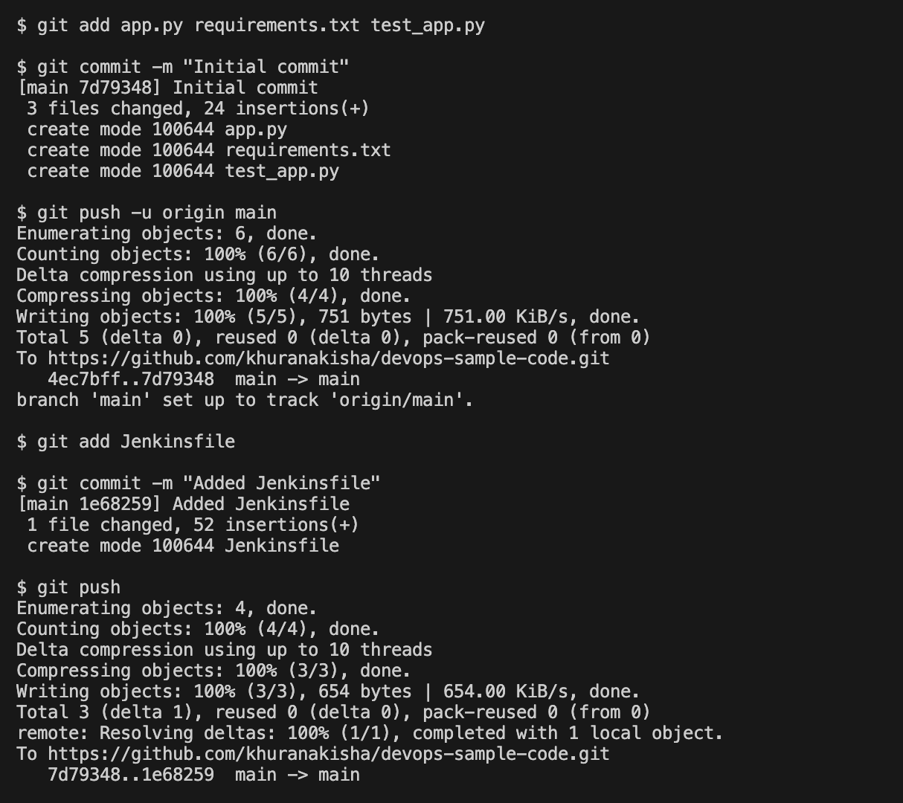
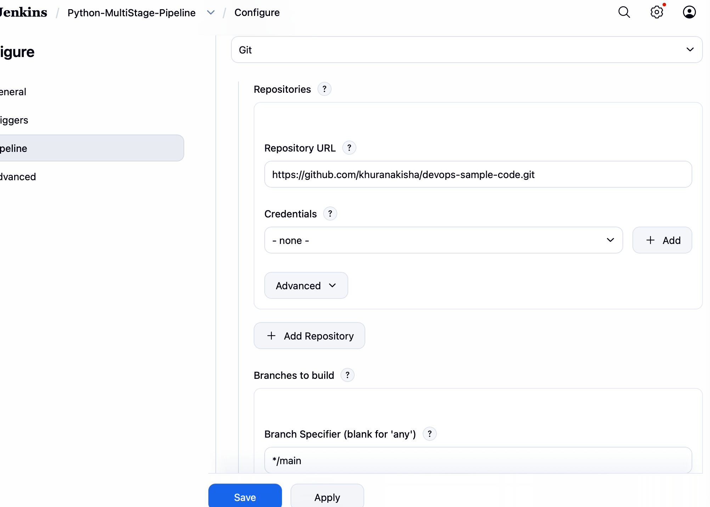
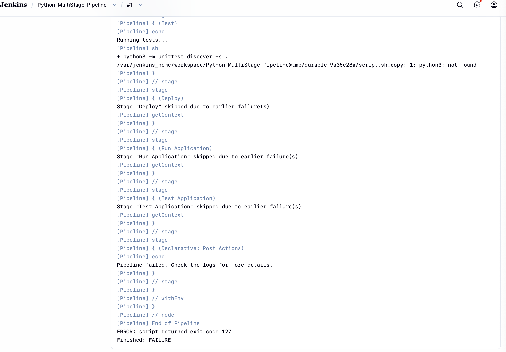
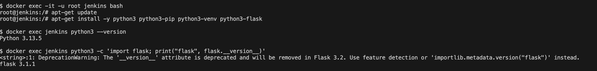
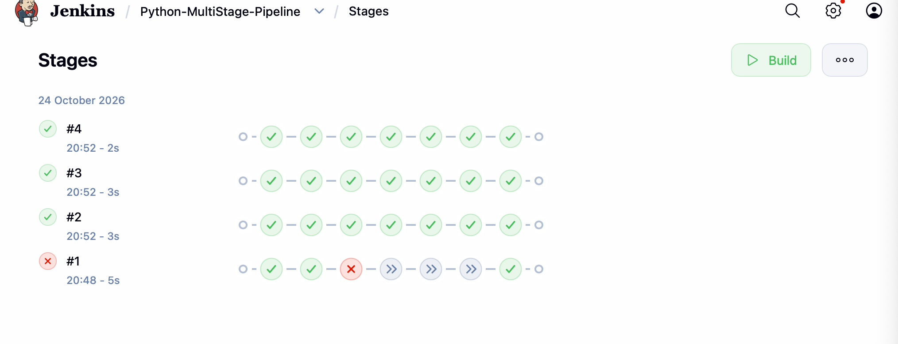
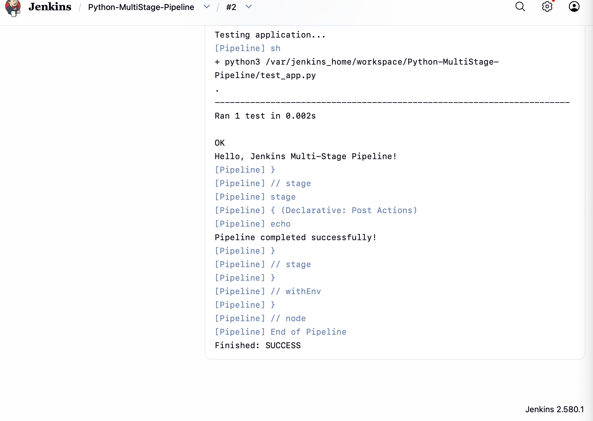

# Exercise 9: Jenkins Multi-Stage Pipeline, Deploying a Python Application

## Objective
Create and run a Jenkins Pipeline with several stages (Build, Test, Deploy, Run, Test) for a sample Flask application, and learn to fix common build errors.

## Scenario
Automate the CI/CD pipeline for a Python Flask application:
1. **Build:** prepare the application.
2. **Test:** run the unit tests.
3. **Deploy:** copy the application to a deployment directory.
4. **Run Application** and **Test Application:** start the app and run the tests again.

## Environment
| Tool | Version |
|---|---|
| OS | macOS (Apple Silicon, arm64) |
| Jenkins | `jenkins/jenkins:lts` in Docker (set up in Exercise 7) |
| Pipeline plugin | installed with the suggested plugins |

## Files in this Folder
| File | Purpose |
|---|---|
| `app.py` | Flask application returning "Hello, Jenkins Multi-Stage Pipeline!" |
| `requirements.txt` | `flask==2.1.2` |
| `test_app.py` | Unit test for the home page |
| `Jenkinsfile` | The five-stage declarative pipeline |
| `screenshots/` | Evidence of each step |

The same files live in the companion repository Jenkins pulls from: **[khuranakisha/devops-sample-code](https://github.com/khuranakisha/devops-sample-code)**.

## Steps

### 1. Application files and Git
`app.py`, `requirements.txt` and `test_app.py` were pushed to `devops-sample-code`, then the `Jenkinsfile` was added and pushed.
```bash
git add .
git commit -m "Initial commit"
git push -u origin main
git add Jenkinsfile
git commit -m "Added Jenkinsfile"
git push
```


### 2. The Jenkinsfile
Stages: **Build** (message), **Test** (`python3 -m unittest discover -s .`), **Deploy** (copies `app.py` to `python-app-deploy/`), **Run Application** (starts the app in the background) and **Test Application** (`python3 test_app.py`). A `post` block prints a message on success or failure.

### 3. Create the Pipeline job
New Item `Python-MultiStage-Pipeline`, type **Pipeline**, Definition **Pipeline script from SCM**, SCM **Git**, repository `https://github.com/khuranakisha/devops-sample-code.git`, branch `*/main`, Script Path `Jenkinsfile`.



### 4. First run: the expected build error
Build #1 failed because the Jenkins container has no Python: `python3: not found`.



### 5. Fix: install Python in the Jenkins container
```bash
docker exec -it -u root jenkins bash
apt-get update
apt-get install -y python3 python3-pip python3-venv python3-flask
```


### 6. Run the pipeline again
Build #2 passed all five stages.




## Key Learnings
- A **Jenkinsfile** keeps the pipeline definition in source control next to the code.
- Declarative pipelines break the work into stages, so a failure shows exactly where it happened.
- A pipeline runs in the Jenkins environment, so the tools it needs (here Python) must be installed there.
- Reading the console output is the way to diagnose a failed build.

## Comparison with the Lab Manual
| Manual | What was done | Reason |
|---|---|---|
| `apt install python3.11-venv` and `apt install pip` | `apt-get install -y python3 python3-pip python3-venv python3-flask` | the Jenkins image's Debian uses different package names for these; `python3-flask` provides Flask because pip cannot install into the system Python there |
| Jenkins uses the repository's default branch | Branch Specifier set to `*/main` | Jenkins defaults to `master`; the repository branch is `main` |
| Sample output shows another user, repository and commit hashes | real values differ | generated per run |
All other files and stages are exactly as in the manual.
