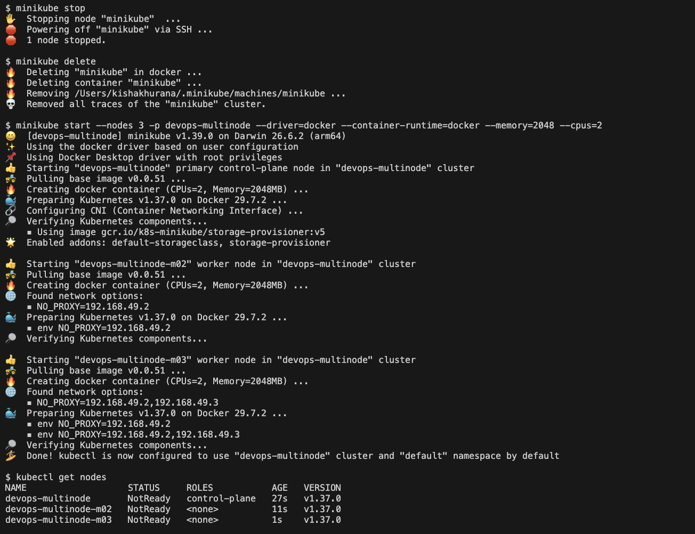
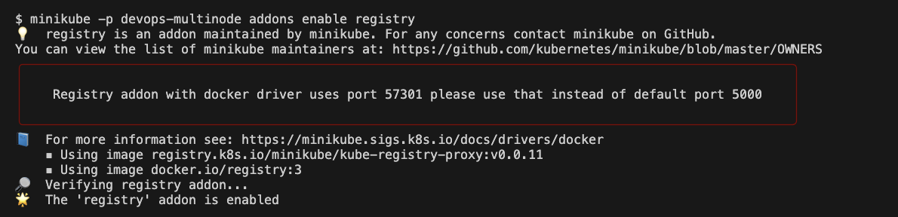
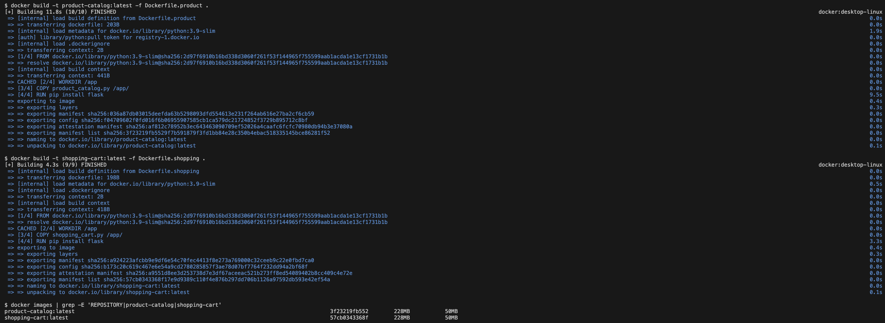
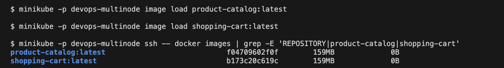
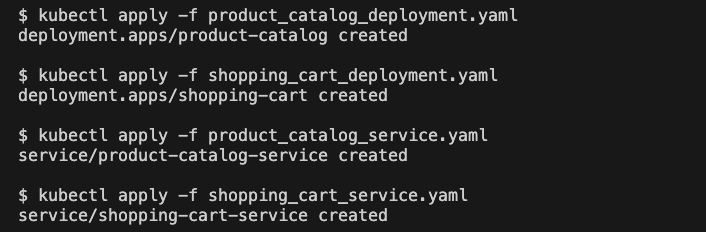
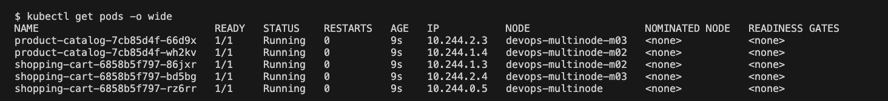
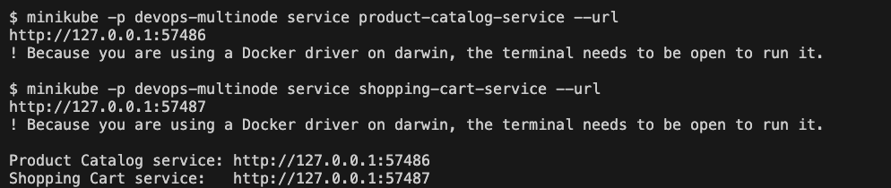
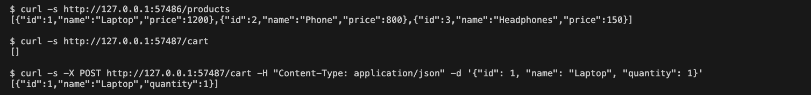

# Exercise 10: Multi-Node Kubernetes Cluster with Multiple Applications and ReplicaSets

## Storyboard
An e-commerce platform has two services:
1. **Product Catalog** (AppA) lists the available products. It runs with **2 replicas**.
2. **Shopping Cart** (AppB) manages user carts. It runs with **3 replicas**.

Replicas are spread across different nodes, so the services stay available even if one node fails.

## Environment
| Tool | Version |
|---|---|
| OS | macOS (Apple Silicon, arm64) |
| Docker Desktop | Docker 29.9.2 |
| Minikube | v1.39.0, profile `devops-multinode`, 3 nodes, Docker driver, docker container runtime |
| kubectl client | v1.37.1 |

## Files in this Folder
| File | Purpose |
|---|---|
| `product_catalog.py` | Flask service with `GET /products` on port 80 |
| `shopping_cart.py` | Flask service with `GET /cart` and `POST /cart` on port 80 |
| `Dockerfile.product`, `Dockerfile.shopping` | Image definitions for the two services |
| `product_catalog_deployment.yaml` | Deployment, 2 replicas, pod anti-affinity |
| `shopping_cart_deployment.yaml` | Deployment, 3 replicas, pod anti-affinity |
| `product_catalog_service.yaml`, `shopping_cart_service.yaml` | NodePort Services |
| `screenshots/` | Evidence of each step |

## Steps and Commands

### Step 0-1a: Clean up and start a 3-node cluster
```bash
minikube stop
minikube delete
minikube start --nodes 3 -p devops-multinode --driver=docker --container-runtime=docker --memory=2048 --cpus=2
kubectl get nodes
```


### Step 1b: Enable the registry add-on
With a multi-node cluster `eval $(minikube docker-env)` cannot be used directly, so images are built with the normal Docker and loaded into every node.
```bash
minikube -p devops-multinode addons enable registry
```


### Step 2-4: The applications and Docker images
```bash
docker build -t product-catalog:latest -f Dockerfile.product .
docker build -t shopping-cart:latest -f Dockerfile.shopping .
```


### Step 5: Load the images into the cluster
```bash
minikube -p devops-multinode image load product-catalog:latest
minikube -p devops-multinode image load shopping-cart:latest
minikube -p devops-multinode ssh -- docker images
```


### Step 6-7: Deploy the applications and expose the services
```bash
kubectl apply -f product_catalog_deployment.yaml
kubectl apply -f shopping_cart_deployment.yaml
kubectl apply -f product_catalog_service.yaml
kubectl apply -f shopping_cart_service.yaml
```


### Step 8: Verify the pod distribution
```bash
kubectl get pods -o wide
```
`podAntiAffinity` with `topologyKey: kubernetes.io/hostname` stops two replicas of the same app from running on the same node, so each Pod of an app is on a different node.



### Step 9: Access the services
```bash
minikube -p devops-multinode service product-catalog-service --url
minikube -p devops-multinode service shopping-cart-service --url
```
The terminals running these commands must stay open (Docker driver on macOS).



### Step 10: Test with curl
```bash
curl <product-catalog-url>/products
curl <shopping-cart-url>/cart
curl -X POST <shopping-cart-url>/cart -H "Content-Type: application/json" -d '{"id": 1, "name": "Laptop", "quantity": 1}'
```
The catalog returns the three products, the cart starts empty and the POST returns the cart with the added item.



## Summary
Two Python applications were deployed on a three-node Minikube cluster, with 2 and 3 replicas, each replica on a different node. This improves availability and fault tolerance, because losing a node leaves the other replicas serving traffic.

## Comparison with the Lab Manual
| Manual | What was done | Reason |
|---|---|---|
| `minikube start --nodes 3 -p devops-multinode --force` | `--driver=docker --container-runtime=docker --memory=2048 --cpus=2` instead of `--force` | `--force` is only needed when running as root (not the case on macOS); the docker runtime is needed for `minikube ssh -- docker images`; 2 GB per node lets three nodes fit in Docker Desktop's memory |
| `shopping_cart_deployment.yaml` uses `namespace: devops-exercise` | changed to `namespace: default` | the manual never creates that namespace, and the Services and the other Deployment are in `default`, so the Service could not find the Pods otherwise |
| `minikube service <name>` opens the services | `minikube service <name> --url` | prints the URL for the `curl` tests without opening blank pages in the browser; the tunnel terminal still stays open |
| Sample output with Linux ports and node names | real ports and Pod names differ | generated per run |
